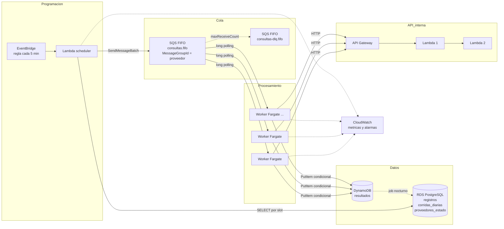
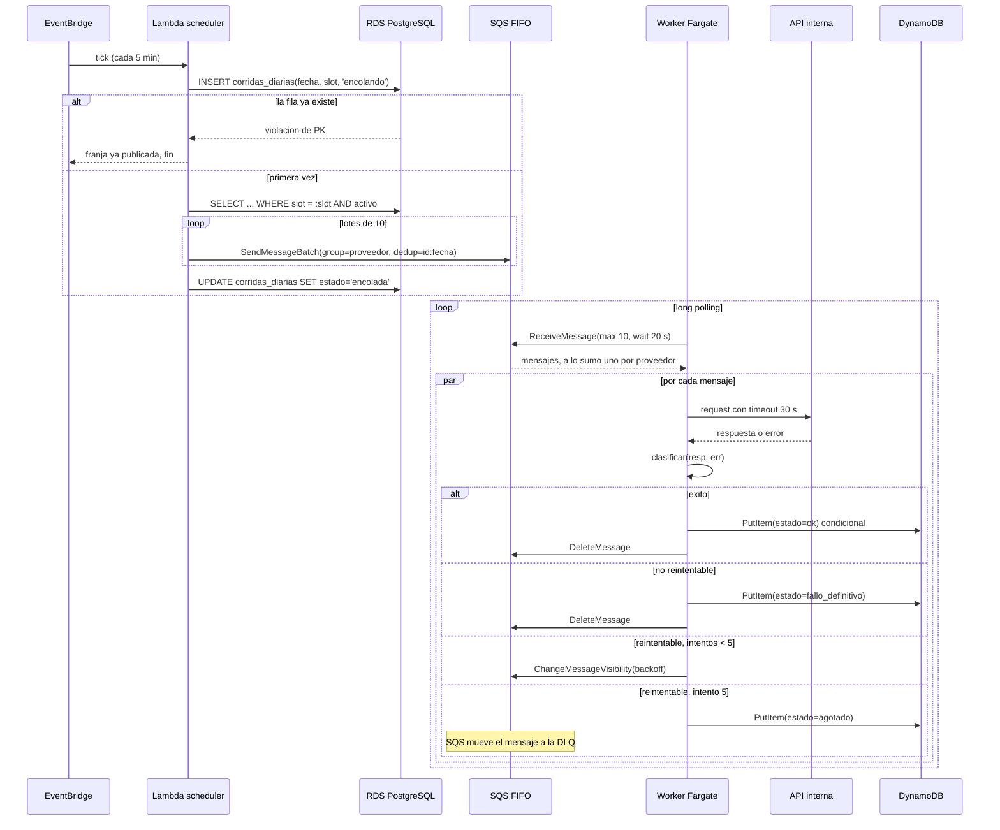

# Consultas diarias distribuidas a una API interna

Prueba de concepto en Go del diseño descrito en [docs/specs/2026-11-08-consultas-diarias-design.md](docs/specs/2026-11-08-consultas-diarias-design.md). Este README resume el diseño, las decisiones y cómo correr la POC; la spec tiene el detalle y los números.

## 1. Qué es

Hay una tabla con N registros (`id, proveedor, endpoint, body`), hoy un millón y con crecimiento esperado de N veces. Cada registro es una consulta que hay que hacer una vez por día a una API interna (API Gateway que ejecuta dos Lambdas), repartiendo la carga a lo largo del día, guardando el resultado, distinguiendo errores reintentables de los que no lo son y sin hacer nunca dos requests simultáneos al mismo proveedor. Todo en AWS, en una sola cuenta y región.

La respuesta en una frase: **una cola SQS FIFO con `MessageGroupId = proveedor` garantiza la serialización por proveedor, un scheduler que corre cada 5 minutos publica la franja del día que corresponde, y workers en Fargate consumen la cola, llaman a la API y guardan el resultado en DynamoDB.** El requisito de no concurrencia convierte el problema en una cola independiente por proveedor con un único consumidor; el resto del diseño se ordena alrededor de eso.

## 2. Arquitectura

### Componentes



Cada pieza responde una sola pregunta. El scheduler decide **cuándo** se consulta cada registro: la tabla fuente tiene una columna `slot` (0..287) que reparte los registros de cada proveedor de forma uniforme en las 288 franjas de 5 minutos del día. La cola decide **cuántos a la vez** por proveedor: uno. El worker sabe **cómo** llamar a la API y qué hacer con cada respuesta. El worker no conoce la tabla fuente, el scheduler no conoce la API y la cola no conoce a ninguno de los dos, así que cada parte se escala, se despliega y se prueba por separado.

### Secuencia



La parte de arriba es idempotente por construcción: la PK `(fecha, slot)` de `corridas_diarias` impide publicar dos veces la misma franja, y el `MessageDeduplicationId` cubre el reenvío de un lote que en realidad había llegado. La parte de abajo descansa en una garantía de SQS FIFO: mientras un mensaje de un grupo está en vuelo o esperando su backoff, ningún otro mensaje de ese grupo se entrega. Por eso un mismo `ReceiveMessage` trae a lo sumo un mensaje por proveedor y el worker puede procesarlos en paralelo sin violar la serialización. El reintento no necesita estado propio: el número de intento es `ApproximateReceiveCount` y el backoff es la visibilidad del mensaje.

## 3. Decisiones clave

| Decisión | Por qué | Alternativa descartada | Costo de la elección |
|---|---|---|---|
| SQS FIFO con `MessageGroupId = proveedor` | La serialización por proveedor la da un servicio gestionado; no hay locks propios que mantener. | Locks condicionales en DynamoDB; Kinesis por partition key; Postgres como cola con `SKIP LOCKED`. | Un mensaje en backoff bloquea a todo su proveedor; dependemos de la semántica de grupos de SQS. |
| Workers en ECS Fargate | Las dos Lambdas de la API comparten la cuota de concurrencia de la cuenta; workers Lambda competirían con ellas. Carga constante 24 h. | Lambda con event source mapping de SQS FIFO (válida con cuota reservada). | Hay que operar un servicio ECS: imagen, autoscaling, graceful shutdown. |
| Scheduler periódico + columna `slot` | El delay máximo de SQS es 15 min; una columna indexada resuelve la distribución con una consulta. | Delay por mensaje; un schedule de EventBridge Scheduler por registro. | Un proceso más a cuidar y una franja que puede perderse (ver notas). |
| RDS for PostgreSQL, no Aurora | Menos de mil consultas por día sobre una tabla chica y predecible; Postgres en Docker es el mismo motor. | Aurora (réplicas, storage de 128 TB, Serverless v2 que no se usan). | Failover Multi-AZ de 60-120 s contra ~30 s; se tolera perder una franja. |
| DynamoDB para resultados | Append-only que crece 1M filas por día, acceso por clave y TTL nativo, sin gestionar particiones. | Tabla `resultados` particionada por fecha en el mismo RDS. | Dos motores de datos; consultas analíticas requieren exportar o un GSI. |
| 5 intentos con backoff hasta 30 min, luego DLQ | Cubre ~40 min de degradación de la API sin que un registro secuestre a su proveedor por horas. | 3 intentos (más throughput) o 7 (más resiliencia). | Un registro problemático puede quitarle ~40 min de capacidad a su proveedor. |

### Notas de implementación

Decisiones tomadas al construir la POC que la spec no fija:

- **El día del sistema es UTC.** Franja, fecha lógica y TTL se calculan en UTC; `SlotActual` normaliza sus entradas a UTC antes de calcular.
- **Sin catch-up.** Si el proceso scheduler está caído durante una franja, esa franja no se publica después. Queda como fila ausente en `corridas_diarias`, que en producción es la alarma "franja perdida".
- **Una franja cuyo `Enviar` falla queda en `encolando`** y el scheduler no la reintenta. La spec dice que una franja perdida se detecta por la *ausencia* de fila; eso sólo es cierto si el scheduler nunca la empezó. Es una limitación conocida de la POC: en producción haría falta reclamar las filas en `encolando` más viejas que una franja y volver a publicarlas, cosa que la deduplicación de SQS y la escritura condicional en DynamoDB hacen segura.
- **Un 2xx con body vacío o que no es JSON es `fallo_definitivo`.** Se asume que la API siempre responde JSON; volver a preguntar no cambiaría el body y bloquearía al proveedor.
- **La política de medianoche está implementada en el scheduler** (lee `proveedores_estado.pendientes_ayer`), pero en la POC nadie actualiza esa tabla porque el job nocturno quedó fuera de alcance. Está cubierta por tests unitarios con fakes.
- **Datos de la demo.** El seed genera 100.000 registros sobre 200 proveedores con una distribución Zipf de exponente 1,1. El proveedor más grande concentra alrededor de 21.000 registros, unos 73 por franja.
- **Latencia del mock en la demo comprimida.** Con `ESCALA_TIEMPO=150` una franja dura 2 s. Si el mock mantuviera su latencia real, el proveedor más grande (~73 mensajes por franja) quedaría saturado por la compresión y no por el diseño. Por eso `deploy/demo.env` baja la latencia del mock a ~2 ms, el equivalente de ~300 ms reales divididos por la escala. El informe sigue calculando la saturación con K × L / 86400.
- **Fecha lógica única por corrida en los tests de integración** (`fechaUnica()`). Los ids de deduplicación de SQS FIFO sobreviven a un `PurgeQueue` durante 5 minutos; con una fecha fija, una segunda corrida dentro de esa ventana perdería mensajes en silencio.

## 4. El límite que no se puede diseñar

Con un único request en vuelo por proveedor, un proveedor P con K_P registros y latencia media L_P (en segundos, reintentos incluidos) no puede completar más de 86.400 / L_P consultas por día. De ahí sale la única métrica que importa por proveedor:

```
saturacion_P = K_P × L_P / 86.400
```

Si `saturacion_P < 1`, el proveedor termina en el día: en cada franja recibe K_P / 288 mensajes y los procesa en K_P × L_P / 288 segundos, menos que los 300 s de la franja. Si `saturacion_P ≥ 1`, su cola crece franja a franja y no se vacía nunca. **Ningún número de workers lo arregla**, porque el cuello de botella es el requisito de serialización y no la infraestructura. Con L = 1 s el techo es 86.400 registros por proveedor por día; a 10× el throughput global escala sumando workers, pero ese techo por proveedor no se mueve.

Lo que el diseño sí puede hacer es medirlo y decirlo a tiempo. El sistema publica `saturacion_P` con la latencia observada el día anterior y alarma por encima de 0,8. Esa alarma es la conversación con el dueño del proveedor: o se negocia un límite de concurrencia mayor a 1 (que SQS FIFO soporta con `MessageGroupId = proveedor#shard`), o se reducen sus registros, o se acepta que no termina en el día.

La **política de medianoche** evita que un proveedor saturado acumule deuda sin límite. Si al cambiar el día un proveedor todavía tiene mensajes pendientes del día anterior, el scheduler no encola sus registros nuevos y lo marca como atrasado en `proveedores_estado`; la corrida del día anterior termina primero. La alternativa, encolar igual y dejar que la deuda se drene, es más simple, pero con un proveedor saturado no converge nunca y además mezcla resultados de días distintos. El costo de la política es explícito: un proveedor atrasado pierde un día de consultas en lugar de arrastrar un retraso creciente.

## 5. Cómo correr la POC

Requisitos: Docker Desktop con Compose v2 y Go 1.26. Todo corre localmente: Postgres en contenedor, SQS y DynamoDB en LocalStack, y un mock de la API en Go. El código del scheduler y del worker es el mismo que correría en AWS; sólo cambia el endpoint del SDK.

```bash
make infra             # levanta postgres, localstack y api-mock
make test              # unitarios, sin I/O: clasificación, backoff, slots, scheduler y worker con fakes
make test-integration  # contra el compose: adaptadores, serialización, reintentos, DLQ
make demo              # día comprimido con 100.000 registros y 10 workers
make informe           # resumen de la corrida
make down              # baja todo y borra los volúmenes
```

`make test` no necesita Docker. `make test-integration` levanta la infraestructura si no está arriba y corre siete pruebas: ida y vuelta por SQS, escritura condicional en DynamoDB, idempotencia de la franja en Postgres, serialización (dos proveedores, 20 mensajes cada uno, 5 workers con concurrencia 4, sin ninguna violación en el mock), reintento exitoso, fallo no reintentable en una sola pasada y agotamiento hacia la DLQ. La prueba de DLQ tarda hasta ~90 s porque la cola usa el visibility timeout de producción, 60 s.

El mock lleva un contador de requests en vuelo por proveedor y responde 409 si alguna vez ve dos simultáneos del mismo proveedor. `GET localhost:8080/stats` devuelve `max_en_vuelo` por proveedor, `violaciones` y `requests`. Lo que hay que ver después de cualquier corrida es `violaciones: 0` y ningún proveedor con `max_en_vuelo` mayor a 1: es la verificación empírica de la invariante central, no un argumento.

`make demo` carga el seed, calcula los slots con la misma consulta SQL de la spec y arranca el scheduler con `ESCALA_TIEMPO=150` (una franja de 5 minutos dura 2 s, el día completo ~10 minutos) y 10 réplicas del worker. El mock inyecta errores con las probabilidades de `deploy/demo.env` (500, 503, 429 y 400) para ejercitar reintentos y fallos definitivos. Con `make logs` se ven las franjas encolándose y los workers procesando.

## 6. Mapeo POC → producción

| Producción | POC |
|---|---|
| RDS for PostgreSQL | Postgres en contenedor |
| SQS FIFO + DLQ | LocalStack |
| DynamoDB | LocalStack |
| EventBridge + Lambda scheduler | Contenedor `scheduler` con ticker interno que llama a la misma función |
| ECS Fargate workers | Contenedor `worker`, escalable con `docker compose up --scale worker=N` |
| API Gateway + 2 Lambdas | Contenedor `api-mock` en Go |

Las interfaces `Cola`, `Fuente` y `Resultados` en `internal/` son el borde entre la lógica y AWS. Toda la lógica de negocio se prueba con fakes en memoria; los adaptadores reales se prueban contra LocalStack y Postgres.

## 7. Resultados de la demo

La demo se corre desde cero:

```bash
make down && make demo
# esperar ~10 minutos, lo que dura el día comprimido
make informe
```

`make informe` recorre la tabla `resultados` de DynamoDB e imprime la cantidad de resultados por estado (`ok`, `fallo_definitivo`, `agotado`), la latencia p50 y p95, los cinco proveedores con mayor saturación estimada con su K, su L efectiva (latencia por intentos) y K × L / 86400, y los mensajes visibles y en vuelo de `consultas.fifo` y `consultas-dlq.fifo`. Al final muestra la salida de `GET /stats` del mock, con `violaciones` y el máximo en vuelo por proveedor.

Un detalle para leer la saturación: L es la latencia medida dentro del día comprimido, donde el mock responde en ~2 ms. Para obtener la saturación equivalente con latencia real hay que multiplicar el valor impreso por `ESCALA_TIEMPO` (150).

La salida medida de la corrida queda registrada en `docs/demo-resultados.md`.

## 8. Qué quedó fuera

Explícitamente no implementado en la POC, descrito en la spec con los valores propuestos:

- Autoscaling de Fargate por `ApproximateNumberOfMessagesVisible`.
- Alarmas de CloudWatch (DLQ con mensajes, cola envejecida, proveedor saturado, franja perdida).
- Overflow a S3 de respuestas de más de ~300 KB.
- Infraestructura como código.
- Job nocturno que actualiza `proveedores_estado`. En la POC la saturación se calcula al final de la corrida comprimida con `make informe`.

### Qué haría distinto con más tiempo

- **Reclamar franjas en `encolando`.** El scheduler debería buscar filas en `encolando` más viejas que una franja y volver a publicarlas. Es seguro gracias a la deduplicación de SQS y a la escritura condicional en DynamoDB, y cierra el hueco de una franja cuyo envío falló a mitad de camino.
- **Catch-up de franjas perdidas.** Al arrancar, recorrer desde la última franja publicada del día hasta la actual y publicar las que falten, en lugar de depender sólo de la alarma.
- **`Recibir` acotado por capacidad libre.** Hoy el worker pide `concurrencia` mensajes en cada ciclo aunque tenga goroutines ocupadas; los que esperan turno consumen visibility timeout sin procesarse. Debería pedir sólo tantos como lugares libres tenga.
- **Mensajes venenosos en `Recibir`.** Un body que no deserializa hace fallar todo el lote recibido, y los demás mensajes del lote suman intentos sin culpa. Lo correcto es aislar el mensaje malformado, mandarlo a la DLQ y procesar el resto.

## 9. Ciclo de vida y plan

- Ciclo de vida de desarrollo (ramas, CI, Terraform, entornos, despliegue, operación): [spec, sección 13](docs/specs/2026-11-08-consultas-diarias-design.md#13-ciclo-de-vida-de-desarrollo).
- Plan de desarrollo por hitos, ordenado por riesgo: [spec, sección 14](docs/specs/2026-11-08-consultas-diarias-design.md#14-plan-de-desarrollo).
- Plan de implementación de la POC, tarea por tarea: [docs/plans/2026-11-08-poc-consultas-diarias.md](docs/plans/2026-11-08-poc-consultas-diarias.md).
