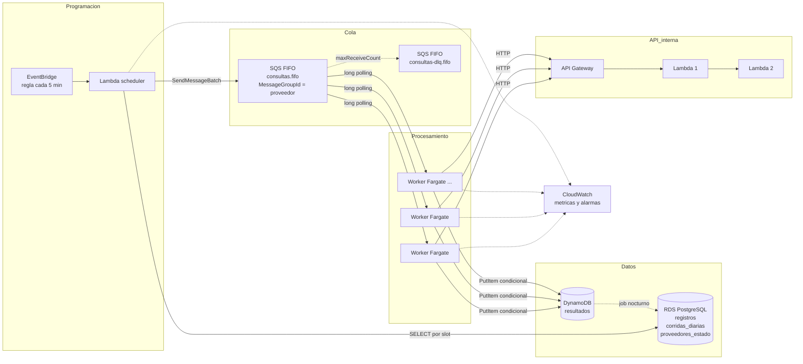
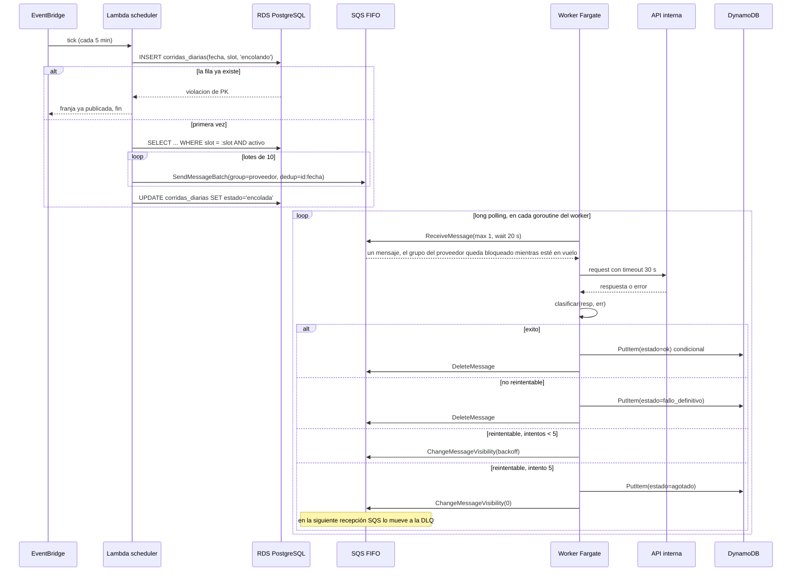

# Consultas diarias distribuidas a una API interna: diseño

Fecha: 2026-11-08

## 1. Problema

Existe una tabla con N registros (`id, proveedor, endpoint, body`). Cada registro describe una consulta que hay que hacer una vez por día a una API interna. Se pide:

- Ejecutar la consulta de cada registro una vez al día, de forma automática, distribuyendo las consultas a lo largo del día.
- Guardar el resultado en una base de datos.
- Manejar errores distinguiendo los que se pueden reintentar de los que no.
- Evitar concurrencia a un mismo proveedor.

Restricciones dadas:

- Todo en AWS, misma cuenta y misma región.
- La tabla tiene 1 millón de filas y puede crecer N veces.
- La API interna ejecuta dos Lambdas por llamada.

## 2. Supuestos

El problema deja varios puntos abiertos. Los fijo acá para que el diseño sea verificable y para que, si alguno no aplica, quede claro qué cambia.

| # | Supuesto | Impacto si no se cumple |
|---|---|---|
| S1 | "Evitar concurrencia a un mismo proveedor" significa **a lo sumo un request en vuelo por proveedor** en todo el sistema. | Si fuera un límite N por proveedor, SQS FIFO sigue sirviendo usando `MessageGroupId = proveedor#shard` con N shards. |
| S2 | Hay **cientos de proveedores con distribución sesgada**: pocos proveedores concentran gran parte de los registros. | Con distribución pareja el límite por proveedor (sección 5) nunca se alcanza y la métrica de saturación es informativa pero no crítica. |
| S3 | La API interna es **API Gateway → Lambda → Lambda, síncrona**. La respuesta HTTP contiene el resultado. Timeout máximo de API Gateway: 29 s. | Si la segunda Lambda fuera asíncrona, el resultado no vendría en la respuesta y habría que diseñar un callback o un polling. |
| S4 | Las consultas son **idempotentes** (son lecturas). Repetir una no tiene efectos secundarios. | Si no lo fueran, la reserva en DynamoDB se mueve antes de la llamada (ver sección 6.4). |
| S5 | Los resultados se guardan como **histórico append-only**: una fila por registro y día. | Si sólo importara el último resultado, alcanzaría un upsert y la tabla no crecería. |
| S6 | Las dos Lambdas de la API comparten la **cuota de concurrencia de la cuenta** (1.000 por defecto) con cualquier Lambda que agreguemos. | Es un dato de la plataforma, no un supuesto negociable. Condiciona dónde corren los workers. |

## 3. Números que gobiernan el diseño

| Dato | Valor |
|---|---|
| Registros / día (base) | 1.000.000 → 11,6 req/s promedio |
| Registros / día (10×) | 10.000.000 → 116 req/s promedio |
| Lambdas consumidas por request | 2 |
| Capacidad máxima de un proveedor con 1 request en vuelo | `86.400 / L` consultas por día, con `L` la latencia media en segundos. Con `L = 1 s`: 86.400 por día. |
| Franjas de 5 minutos por día | 288 |
| Registros por franja (base / 10×) | ~3.500 / ~35.000 |

La consecuencia central: el requisito de serialización por proveedor convierte el problema en **una cola independiente por proveedor con un único consumidor**. El throughput global es la suma de los proveedores. El límite real del sistema no es la infraestructura sino el proveedor más cargado, y ese límite es físico: ninguna arquitectura lo supera sin relajar el requisito.

## 4. Arquitectura

### 4.1 Diagrama de componentes



### 4.2 Componentes

1. **Tabla fuente** (`registros`) en RDS for PostgreSQL. Es la tabla original con dos columnas agregadas: `slot` (franja del día asignada, 0..287) y `activo`.
2. **Scheduler**: una regla de EventBridge cada 5 minutos invoca una Lambda. La Lambda lee los registros del slot actual, los publica en la cola en lotes de 10 y registra la franja en `corridas_diarias`. Corre 288 veces por día durante segundos, así que su consumo de cuota Lambda es despreciable.
3. **Cola SQS FIFO** `consultas.fifo`, con `MessageGroupId = proveedor` y `MessageDeduplicationId = id:fecha`. Tiene asociada la DLQ `consultas-dlq.fifo` con `maxReceiveCount = 5`.
4. **Workers** en ECS Fargate: un servicio Go con N tareas que hacen long polling, llaman a la API, clasifican la respuesta, escriben el resultado y borran o reprograman el mensaje. Autoescalado por `ApproximateNumberOfMessagesVisible`.
5. **API interna**: caja negra. La tratamos con timeout propio de 30 s y una clasificación de errores explícita.
6. **Resultados** en DynamoDB, tabla `resultados`, append-only con TTL.
7. **Observabilidad**: métricas custom en CloudWatch, alarmas sobre la DLQ, sobre la edad del mensaje más viejo y sobre la saturación por proveedor.

### 4.3 Por qué esta separación

Cada componente responde una sola pregunta:

- El scheduler decide **cuándo** se consulta cada registro.
- La cola garantiza **cuántos a la vez** por proveedor.
- El worker sabe **cómo** llamar y qué hacer con cada respuesta.

El worker no conoce la tabla fuente. El scheduler no conoce la API. La cola no conoce ninguna de las dos. Cada pieza se escala, se despliega y se testea por separado.

### 4.4 Diagrama de secuencia



Mientras un mensaje de un proveedor está en vuelo o esperando backoff, SQS FIFO no entrega ningún otro mensaje de ese grupo a ningún consumidor. Esa es la garantía que resuelve el requisito de no concurrencia. Tiene un matiz: un mismo `ReceiveMessage` con `max > 1` sí puede devolver varios mensajes consecutivos del mismo grupo. Por eso cada goroutine del worker pide un mensaje por vez y lo termina antes de pedir el siguiente; el costo es un `ReceiveMessage` por consulta, despreciable a 1M por día.

## 5. Distribución horaria y capacidad

### 5.1 Qué hay que distribuir

Repartir el millón de registros en 288 franjas de forma global no alcanza. Como cada proveedor es una cola serial, lo que tiene que quedar parejo a lo largo del día es **cada proveedor**. Si un proveedor con 50.000 registros cae entero en la mañana, su cola se apila aunque el sistema global esté tranquilo.

### 5.2 Asignación de slot

Para cada proveedor con K registros, se ordenan por `id` y se asigna `slot = floor(rank × 288 / K)`. Cada proveedor queda uniforme en sus 288 franjas, y la suma de proveedores uniformes es uniforme. Es determinista e idempotente:

```sql
UPDATE registros r SET slot = s.slot
FROM (
  SELECT id,
         (ROW_NUMBER() OVER (PARTITION BY proveedor ORDER BY id) - 1) * 288
           / COUNT(*) OVER (PARTITION BY proveedor) AS slot
  FROM registros
  WHERE activo
) s
WHERE r.id = s.id;
```

Se recalcula una vez por día (o ante altas y bajas masivas). El índice `(slot, proveedor) WHERE activo` hace que la lectura de la franja sea un range scan de ~3.500 filas.

### 5.3 Límite por proveedor y saturación

Un proveedor P con K_P registros y latencia media L_P (incluyendo reintentos) puede completar como máximo `86.400 / L_P` consultas por día. Definimos:

```
saturacion_P = K_P × L_P / 86.400
```

- Si `saturacion_P < 1`, el proveedor termina en el día. Dentro de una franja recibe `K_P / 288` mensajes y los procesa en `K_P × L_P / 288` segundos, menos que los 300 s de la franja.
- Si `saturacion_P ≥ 1`, la cola de ese proveedor crece franja a franja y no termina nunca. Ninguna cantidad de workers lo arregla: el cuello es el requisito de serialización.

El sistema publica `saturacion_P` como métrica por proveedor usando la latencia observada el día anterior y dispara alarma con valor mayor a 0,8. Es la única manera honesta de avisar que hay que negociar con ese proveedor un límite de concurrencia mayor a 1, o reducir sus registros.

### 5.4 Política de medianoche

Si al cambiar el día un proveedor todavía tiene mensajes pendientes del día anterior, el scheduler **no encola los registros nuevos de ese proveedor**. Quien lo marca como atrasado (`pendientes_ayer` en `proveedores_estado`) es el job nocturno; el scheduler sólo lee esa marca. La corrida del día anterior termina primero. Esto evita que un proveedor saturado acumule deuda infinita y que los resultados de días distintos se mezclen.

Alternativa descartada: encolar igual y dejar que la deuda se drene. Es más simple, pero si el proveedor está saturado no converge nunca y la cola crece sin límite.

### 5.5 Por qué franjas de 5 minutos

- El delay máximo nativo de SQS es 15 minutos, así que de todas formas hace falta un scheduler periódico; 5 minutos deja margen.
- 288 franjas dan granularidad suficiente: un proveedor con 50 registros recibe uno cada ~30 minutos.
- Franjas más chicas multiplican invocaciones del scheduler sin beneficio; más grandes generan ráfagas de encolado.

### 5.6 Escalado a N×

| Componente | A 1M/día | A 10M/día | Cómo escala |
|---|---|---|---|
| Scheduler | 350 `SendMessageBatch` por franja | 3.500 por franja | Lectura paginada; FIFO high-throughput soporta hasta 70.000 msg/s en la región |
| Cola | 11,6 msg/s | 116 msg/s | Sin cambios |
| Workers | ~12 en vuelo con L = 1 s | ~120 en vuelo | Autoescalado por profundidad de cola |
| DynamoDB | ~12 WCU sostenidas | ~120 WCU | On-demand, sin cambios |
| RDS | 288 range scans por día | Igual, 10× filas por scan | Sin cambios |
| Límite por proveedor | Depende de K_P y L_P | Igual | **No escala**: está medido y alarmado |

## 6. Manejo de errores y reintentos

### 6.1 Clasificación

Un único punto de decisión en el worker: la función pura `clasificar(resp, err) → Clasificacion`.

| Categoría | Condiciones | Acción |
|---|---|---|
| Éxito | 2xx con body parseable | Guardar respuesta, `estado = ok`, borrar mensaje |
| Reintentable | 429, 500, 502, 503, 504, timeout, error de conexión, error al escribir en DynamoDB | `ChangeMessageVisibility` con backoff, no borrar |
| No reintentable | 400, 401, 403, 404, 405, 422, cualquier otro 4xx, 2xx con body inválido | Guardar `estado = fallo_definitivo` con detalle, borrar mensaje |

Un 429 de la API se reintenta y además alimenta la métrica de saturación: indica que el límite real del proveedor está más abajo de lo que suponíamos.

### 6.2 Backoff

| Intento | Espera antes del siguiente |
|---|---|
| 1 | 30 s |
| 2 | 2 min |
| 3 | 8 min |
| 4 | 30 min |
| 5 | A la DLQ |

Jitter de ±20 % en cada espera. El contador de intentos lo provee SQS en `ApproximateReceiveCount`; no hace falta estado propio. Al quinto fallo el worker escribe `estado = agotado` en DynamoDB y pone la visibilidad del mensaje en 0: en la siguiente recepción SQS ve que superó `maxReceiveCount` y lo mueve a la DLQ, sin esperar los 60 s del visibility timeout con el proveedor bloqueado.

### 6.3 Efecto sobre la serialización

Mientras un mensaje espera su backoff, SQS FIFO sigue bloqueando el grupo. Es el comportamiento deseado para 5xx y 429: si el proveedor está mal, seguir golpeándolo con otros registros no ayuda. El costo es que un proveedor con un registro problemático pierde hasta ~40 minutos de capacidad. Por eso:

- El tope es 5 intentos y no más.
- Los 4xx no se reintentan nunca: un body inválido reintentado bloquearía al proveedor sin ninguna posibilidad de éxito.

### 6.4 Idempotencia

Tres capas, cada una cubre una falla distinta:

| Capa | Mecanismo | Falla que cubre |
|---|---|---|
| 1 | `MessageDeduplicationId = id:fecha` (ventana de 5 min de SQS) | El scheduler reintenta un `SendMessageBatch` que en realidad llegó |
| 2 | PK `(fecha, slot)` en `corridas_diarias` | EventBridge reejecuta la Lambda scheduler para una franja ya publicada |
| 3 | `PutItem` con `attribute_not_exists(estado)` en DynamoDB | El worker escribe el resultado, muere antes de borrar el mensaje y SQS lo reentrega |

La llamada a la API se asume idempotente (S4). Si no lo fuera, la capa 3 se convierte en una reserva previa a la llamada: `PutItem(estado = en_proceso)` condicional antes del request, y actualización al terminar.

### 6.5 DLQ

Alarma si `ApproximateNumberOfMessagesVisible > 0` en la DLQ. El redrive nativo de SQS permite reencolar después de resolver la causa. Los mensajes conservan su `MessageGroupId`, así que al volver respetan la serialización.

### 6.6 Fallas de infraestructura propia

| Falla | Comportamiento |
|---|---|
| DynamoDB rechaza la escritura | Reintentable: preferimos volver a consultar antes que perder el resultado |
| RDS no responde durante el scheduler | La Lambda falla, EventBridge reintenta, la capa 2 evita duplicar la franja. Una franja perdida se detecta en la siguiente ejecución por la ausencia de fila en `corridas_diarias` |
| Una tarea Fargate muere con un request en vuelo | El visibility timeout (60 s, mayor al timeout HTTP de 30 s) devuelve el mensaje a la cola |
| Despliegue de workers | Graceful shutdown: ante `SIGTERM` se deja de recibir, se terminan los mensajes en vuelo y se sale antes del visibility timeout |

## 7. Modelo de datos

### 7.1 PostgreSQL: fuente y control

```sql
CREATE TABLE registros (
  id         BIGSERIAL PRIMARY KEY,
  proveedor  TEXT        NOT NULL,
  endpoint   TEXT        NOT NULL,
  body       JSONB       NOT NULL,
  slot       SMALLINT    NOT NULL DEFAULT 0,   -- 0..287
  activo     BOOLEAN     NOT NULL DEFAULT TRUE,
  created_at TIMESTAMPTZ NOT NULL DEFAULT now()
);
CREATE INDEX registros_slot_idx ON registros (slot, proveedor) WHERE activo;

CREATE TABLE corridas_diarias (
  fecha         DATE        NOT NULL,
  slot          SMALLINT    NOT NULL,
  estado        TEXT        NOT NULL,   -- encolando | encolada | fallida
  encolados     INT         NOT NULL DEFAULT 0,
  iniciada_en   TIMESTAMPTZ NOT NULL DEFAULT now(),
  finalizada_en TIMESTAMPTZ,
  PRIMARY KEY (fecha, slot)
);

CREATE TABLE proveedores_estado (
  proveedor       TEXT PRIMARY KEY,
  latencia_p50_ms INT,
  latencia_p95_ms INT,
  saturacion      NUMERIC(4,2),
  pendientes_ayer INT NOT NULL DEFAULT 0,
  actualizado_en  TIMESTAMPTZ
);
```

`registros` es la tabla original más `slot` y `activo`. `corridas_diarias` es el registro de franjas publicadas (capa 2 de idempotencia y detección de franjas perdidas). `proveedores_estado` la actualiza un job nocturno a partir de DynamoDB y alimenta la política de medianoche y la métrica de saturación.

### 7.2 DynamoDB: resultados

Tabla `resultados`, modo on-demand.

| Atributo | Tipo | Notas |
|---|---|---|
| `record_id` (PK) | N | id del registro |
| `fecha` (SK) | S | `2026-11-08` |
| `proveedor` | S | copiado para el GSI |
| `estado` | S | `ok` / `fallo_definitivo` / `agotado` |
| `http_status` | N | último código recibido |
| `intentos` | N | `ApproximateReceiveCount` al cerrar |
| `respuesta` | S / M | body de la API cuando `estado = ok` |
| `error` | S | detalle del último error |
| `latencia_ms` | N | para calcular la saturación |
| `procesado_en` | S | ISO-8601 |
| `ttl` | N | epoch de `procesado_en` + 90 días |

GSI `proveedor-fecha-index`: PK `proveedor`, SK `fecha#estado`. Responde "cómo le fue al proveedor X hoy" y alimenta el job nocturno.

Si una respuesta supera ~300 KB (el límite por item es 400 KB), el worker la guarda en S3 y deja la referencia en `respuesta`. Queda documentado como extensión; no se implementa en la POC.

## 8. Decisiones y alternativas

### 8.1 SQS FIFO como mecanismo de serialización

**Decisión.** La invariante "un request en vuelo por proveedor" la garantiza SQS FIFO con `MessageGroupId = proveedor`. No escribimos locks propios.

**Alternativas descartadas.**

- *Locks en DynamoDB con escrituras condicionales y TTL.* La serialización pasa a ser nuestra: contención, expiraciones en mitad de un request, limpieza de locks huérfanos. Mucha superficie para una garantía que un servicio ya da.
- *Kinesis Data Streams o MSK con partition key = proveedor.* Garantizan orden por shard, pero un shard agrupa varios proveedores y uno lento bloquea a los demás del mismo shard. Serialización más fuerte de la necesaria, más costo operativo, y la distribución horaria igual necesita un scheduler.
- *Postgres como cola con `FOR UPDATE SKIP LOCKED` y advisory locks por proveedor.* Mínimo de componentes y transaccional, pero la base pasa a ser el punto de coordinación de todo el sistema y el polling de cientos de workers sobre una misma tabla genera contención. No aprovecha servicios gestionados.

### 8.2 Workers en Fargate, no en Lambda

**Decisión.** Los workers corren en ECS Fargate.

**Por qué.** La API interna ejecuta dos Lambdas por llamada en la misma cuenta. Si nuestros workers también fueran Lambda, competirían por la misma cuota de concurrencia (1.000 por defecto): a 10× tendríamos ~120 workers en vuelo más ~240 Lambdas de la API disparadas por nosotros. Un pico nuestro podría throttlear la API que consumimos y viceversa. Además la carga es constante durante las 24 horas, el caso donde Fargate es más barato y predecible que Lambda. El scheduler sí es Lambda porque corre segundos cada 5 minutos.

**Alternativa.** Lambda con event source mapping de SQS FIFO, que también respeta grupos. Funciona, y sería la opción si la cuota de la cuenta estuviera separada con concurrencia reservada. Se descarta por la competencia de cuota.

### 8.3 Scheduler periódico, no delay por mensaje

**Decisión.** EventBridge cada 5 minutos más columna `slot`.

**Por qué.** El delay máximo de SQS es 15 minutos, así que no se puede encolar todo a medianoche con delays de hasta 24 horas. EventBridge Scheduler con un schedule por registro soportaría el millón, pero cuesta por invocación y mueve la distribución a un servicio externo cuando una columna indexada la resuelve con una consulta.

### 8.4 RDS for PostgreSQL, no Aurora

**Decisión.** RDS for PostgreSQL, Multi-AZ, instancia chica, autoscaling de storage.

**Carga real sobre la base relacional.**

| Operación | Frecuencia | Costo |
|---|---|---|
| Lectura por `(slot, proveedor)` | 288 / día | Range scan de ~3.500 filas (35.000 a 10×) |
| Insert y update en `corridas_diarias` | 576 / día | Trivial |
| Recálculo de `slot` | 1 / día | UPDATE de 1M filas, segundos |
| Update de `proveedores_estado` | 1 / día | Cientos de filas |

Menos de mil consultas por día sobre una tabla que cabe en memoria. Sin concurrencia de lectores, sin escritura intensiva, sin réplicas.

**Lo que Aurora ofrece y acá no se usa.**

- Hasta 15 réplicas de lectura: tenemos un lector 288 veces al día.
- Storage hasta 128 TB: la tabla fuente son pocos GB incluso a 10×.
- Failover en ~30 s contra 60-120 s de RDS Multi-AZ: el scheduler tolera perder una franja, porque la siguiente ejecución detecta la fila faltante en `corridas_diarias` y la reencola.
- Serverless v2 para picos impredecibles: la carga es perfectamente predecible.

**Lo que cuesta de más.** Instancia ~20 % más cara a igual tamaño, cobro por I/O en el modo estándar, y un motor que no se puede reproducir localmente. Postgres en Docker es exactamente RDS Postgres.

**Cuándo sí elegiría Aurora.** Si la tabla fuente ya vive en un cluster Aurora de la empresa (en ese caso no se mueve), o si a futuro aparecen consumidores de lectura intensiva sobre `registros`.

### 8.5 DynamoDB para resultados, no Postgres

**Decisión.** Resultados en DynamoDB on-demand con TTL.

**Por qué.** Son escrituras append-only que crecen sin límite (1M filas por día, 10M a 10×), se consultan por clave y necesitan expiración. DynamoDB da escalado lineal de escritura, TTL nativo y cero mantenimiento de particiones.

**Alternativa.** Tabla `resultados` en el mismo RDS, particionada por fecha. Funciona a 1M por día, pero obliga a crear y borrar particiones, a dimensionar la instancia por escritura y a competir con el scheduler por la misma base. A 10× el costo operativo crece más que el beneficio de tener todo en un motor.

### 8.6 Límite de 5 intentos

**Decisión.** 5 intentos con backoff hasta 30 minutos, luego DLQ.

**Por qué.** Cada reintento bloquea al proveedor completo. Cinco intentos cubren una degradación de ~40 minutos de la API, que es el orden de un incidente típico, sin que un solo registro pueda secuestrar un proveedor por horas. Bajar a 3 prioriza throughput sobre resiliencia; subir a 7 hace lo inverso. Es un parámetro de configuración.

## 9. Observabilidad

**Métricas custom (CloudWatch, dimensión `proveedor` donde aplica).**

- `consultas_ok`, `consultas_fallo_definitivo`, `consultas_agotadas`.
- `latencia_ms` (p50, p95).
- `saturacion` por proveedor (calculada por el job nocturno).
- `franjas_encoladas`, `registros_encolados` por franja.
- `proveedores_atrasados` (con pendientes del día anterior).

**Métricas nativas.** `ApproximateNumberOfMessagesVisible`, `ApproximateAgeOfOldestMessage`, mensajes en DLQ, tareas Fargate activas, errores e invocaciones de la Lambda scheduler.

**Alarmas.**

| Alarma | Condición | Significado |
|---|---|---|
| DLQ con mensajes | visible > 0 | Hay registros que agotaron reintentos |
| Cola envejecida | edad del más viejo > 30 min | Los workers no dan abasto o la API está caída |
| Proveedor saturado | `saturacion` > 0,8 | Ese proveedor no va a terminar el día |
| Franja perdida | sin fila en `corridas_diarias` para el slot anterior | El scheduler no corrió o falló |

## 10. Seguridad

- Un rol IAM por componente con mínimo privilegio: el scheduler lee RDS y escribe en la cola; el worker lee la cola, escribe en DynamoDB y llama a la API; ninguno tiene permisos del otro.
- Credenciales de RDS en Secrets Manager, rotadas.
- Workers en subredes privadas con VPC endpoints para SQS y DynamoDB; la API interna se alcanza por su dominio privado o endpoint de API Gateway privado.
- Cifrado en reposo en SQS, DynamoDB y RDS con claves KMS administradas.

## 11. Prueba de concepto

### 11.1 Alcance

La POC reproduce la arquitectura localmente con Docker Compose y código Go que usa el SDK de AWS contra LocalStack. El objetivo es que el código del scheduler y del worker sea el mismo que correría en producción, cambiando sólo el endpoint del SDK.

| Producción | POC |
|---|---|
| RDS for PostgreSQL | Postgres en contenedor |
| SQS FIFO + DLQ | LocalStack |
| DynamoDB | LocalStack |
| EventBridge + Lambda scheduler | Contenedor `scheduler` con ticker interno que llama a la misma función |
| ECS Fargate workers | Contenedor `worker`, escalable con `docker compose up --scale worker=N` |
| API Gateway + 2 Lambdas | Contenedor `api-mock` en Go |

### 11.2 API mock

Simula las dos Lambdas con latencia configurable (base y varianza) y una distribución de errores configurable por variable de entorno: probabilidades de 500, 503, 429, timeout y 400. Mantiene un contador atómico de requests en vuelo por proveedor y **falla con 409 si alguna vez supera 1**. Expone `GET /stats` con el máximo observado por proveedor. Esto valida empíricamente la invariante central del problema, no sólo con argumentos.

### 11.3 Tiempo comprimido

El scheduler acepta `ESCALA_TIEMPO`: con valor 150, una franja dura 2 segundos en vez de 300 y el día completo corre en menos de 10 minutos. Los backoffs se escalan con el mismo factor. Permite demostrar un día entero de operación con 100.000 registros en una sesión.

### 11.4 Estructura del repositorio

```
cmd/
  scheduler/    main: ticker + EncolarFranja
  worker/       main: loop de long polling
  api-mock/     main: servidor HTTP que simula la API interna
  seed/         main: dataset sintético con distribución sesgada y cálculo de slots
internal/
  dominio/      tipos puros: Registro, Resultado, Clasificacion
  scheduler/    EncolarFranja, idempotencia, política de medianoche
  worker/       clasificar, backoff, procesarMensaje
  cola/         interfaz Cola e implementación SQS
  fuente/       interfaz Fuente e implementación Postgres
  resultados/   interfaz Resultados e implementación DynamoDB
  apiclient/    cliente HTTP con timeout y mapeo de errores de red
deploy/
  docker-compose.yml, init.sql, localstack-init.sh
docs/
  specs/, plans/
```

Las interfaces `Cola`, `Fuente` y `Resultados` son el borde entre la lógica y AWS. Toda la lógica de negocio se testea con fakes en memoria.

### 11.5 Fuera de alcance de la POC

Explícitamente no implementado, descrito en esta spec con los valores propuestos: autoscaling de Fargate, alarmas de CloudWatch, overflow de respuestas a S3, infraestructura como código, job nocturno de `proveedores_estado` (en la POC la saturación se calcula al final de la corrida comprimida).

## 12. Estrategia de testing

### 12.1 Unitarios (sin I/O)

- `clasificar`: tabla de casos con cada código HTTP, timeout, error de conexión, body inválido.
- `backoff`: duración por intento, jitter dentro de rango, tope en 5.
- `asignarSlot`: con distribuciones sesgadas, cada proveedor queda uniforme y el total por franja no desvía más de un umbral.
- `EncolarFranja` con fakes: idempotencia (segunda llamada no encola), política de medianoche, paginación.
- `procesarMensaje` con fakes: cada categoría termina en la acción correcta; una escritura condicional rechazada no rompe.

### 12.2 Integración (contra compose)

| Caso | Montaje | Verificación |
|---|---|---|
| Serialización | 1 proveedor, 20 mensajes, 5 workers | `GET /stats` del mock muestra máximo 1 en vuelo; ningún 409 |
| Reintento exitoso | Mock falla 2 veces, luego 200 | `intentos = 3`, `estado = ok` |
| Agotado | Mock siempre 503 | Mensaje en DLQ, `estado = agotado` |
| No reintentable | Mock devuelve 400 | `estado = fallo_definitivo` en una sola pasada |
| Idempotencia | Misma franja ejecutada dos veces | Cantidad de mensajes igual a la de una ejecución |

### 12.3 Carga y demostración

Seed de 100.000 registros, 200 proveedores con distribución Pareto (80/20), tiempo comprimido, 10 workers. Se registran en el README: encolados por franja, throughput, latencia por proveedor, proveedores saturados y mensajes en DLQ al final. Es la evidencia que convierte la métrica de saturación en algo concreto.

## 13. Ciclo de vida de desarrollo

- **Ramas y revisión.** Trunk-based con ramas cortas `feat/*`. PR obligatorio con al menos una aprobación y CI verde como condición de merge. Commits convencionales.
- **CI.** `go vet`, `golangci-lint`, unitarios con cobertura mínima, integración levantando compose, build de imágenes multi-stage, escaneo de vulnerabilidades (Trivy o ECR scan), push a ECR con tag del commit.
- **Infraestructura como código.** Terraform bajo `infra/` en el mismo repo: cola FIFO y DLQ, tabla DynamoDB, RDS, cluster ECS y servicio de workers, regla EventBridge, Lambda scheduler, alarmas, roles IAM. Los cambios de infra viajan en el mismo PR que el código que los necesita.
- **Entornos.** `dev` y `prod` en la misma cuenta, separados por prefijo de recursos y rol IAM. `dev` con RDS mínimo y un subconjunto de registros. Promoción manual a `prod` tras validar en `dev`.
- **Despliegue.** Workers: rolling update de ECS con `minimumHealthyPercent = 100` y graceful shutdown. Scheduler: alias de Lambda con versión; el rollback es apuntar el alias a la versión anterior. Migraciones de esquema con `golang-migrate`, siempre compatibles con la versión anterior del código.
- **Operación.** Dashboard de CloudWatch con las métricas de la sección 9. Runbooks cortos en `docs/runbooks/` para "DLQ con mensajes", "proveedor saturado" y "franja perdida".

## 14. Plan de desarrollo

Ordenado por riesgo: primero lo que valida la hipótesis central, después lo periférico.

| Hito | Contenido | Validación |
|---|---|---|
| 0. Esqueleto | Módulo Go, compose con Postgres, LocalStack y api-mock, seed con cálculo de slots | `docker compose up` levanta todo y el seed carga datos |
| 1. Núcleo del worker | `clasificar`, `backoff`, `procesarMensaje` con fakes | Unitarios verdes |
| 2. Adaptadores AWS | Implementaciones de SQS y DynamoDB, cliente HTTP | Un mensaje recorre el flujo completo contra LocalStack |
| 3. Serialización | Test de concurrencia con api-mock asertando máximo 1 por proveedor | El test de invariante pasa con 10 workers |
| 4. Scheduler | `EncolarFranja`, `corridas_diarias`, política de medianoche, tiempo comprimido | Idempotencia y salto de proveedores atrasados |
| 5. Reintentos y DLQ | Casos 5xx, 429, 400, agotado | Integración completa |
| 6. Demo de carga | 100.000 registros, Pareto, tiempo comprimido, métricas de saturación | Tabla de resultados en el README |
| 7. Documentación | README con diagramas, decisiones, alternativas y alcance | Lectura en frío por alguien ajeno al proyecto |
| 8. Producción (fuera de la POC) | Terraform, autoscaling, alarmas, pipeline, runbooks | Despliegue en `dev` |

Los hitos 0 a 7 son el alcance de la POC. El hito 8 queda estimado y descrito en las secciones 9, 10 y 13.
